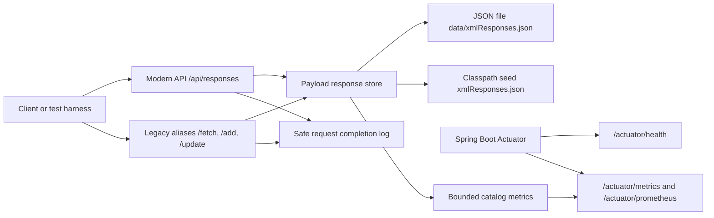
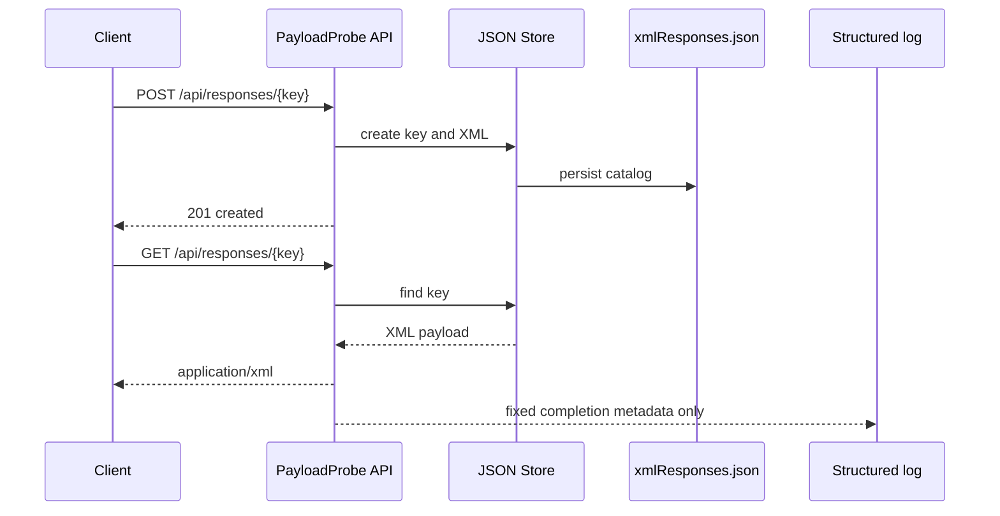
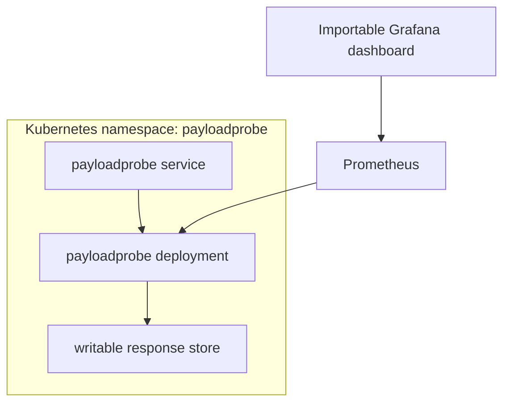

# Architecture

PayloadProbe Lab keeps the application intentionally small: one Spring Boot
service, one JSON-backed response catalog, and clear HTTP boundaries.

## Response-set export and import

`GET /api/response-sets` takes a snapshot of the catalog and returns a
versioned JSON document. `POST /api/response-sets` first parses and validates
every entry, then checks that none of its keys already exist. Only after those
checks pass does the store write the merged catalog to a temporary file in the
catalog directory and atomically replace the old file. A rejected document,
conflict, or persistence failure leaves the in-memory and on-disk catalog
unchanged.

The request body is read through a size-limited stream, so chunked requests do
not bypass the JSON document limit. Startup probes the catalog directory for
atomic-move support and fails clearly if the filesystem cannot provide it.

The import route is intentionally not an overwrite or synchronization API:
it only creates missing keys. As with every mutable route, deployment must
place it behind trusted external access controls because this application does
not provide authentication.

## Component View

## Request Flow

## Deployment Topology

## Design Direction

The first version focuses on a stable modernization foundation. Store-level
metrics cover response lookups, misses, bounded write outcomes, and current
catalog size. One structured completion event records only allow-listed route
templates and fixed server metadata, never keys, request values, XML payloads,
or exception details. An importable Grafana dashboard provides a scan-first view
of scrape health, catalog activity, write outcomes, HTTP outcomes, and mean
latency without adding deployment dependencies. Daily automation can then add
persistence options, security controls, and deployment polish in small verified
steps.
