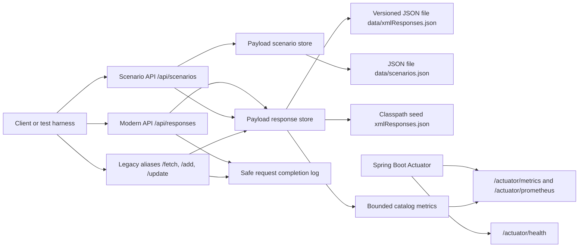
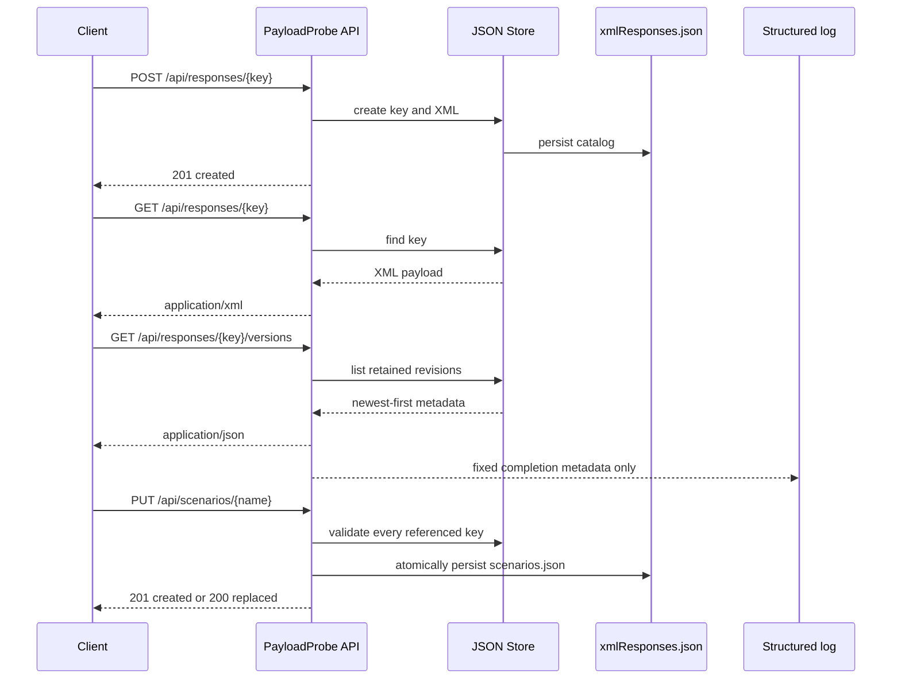
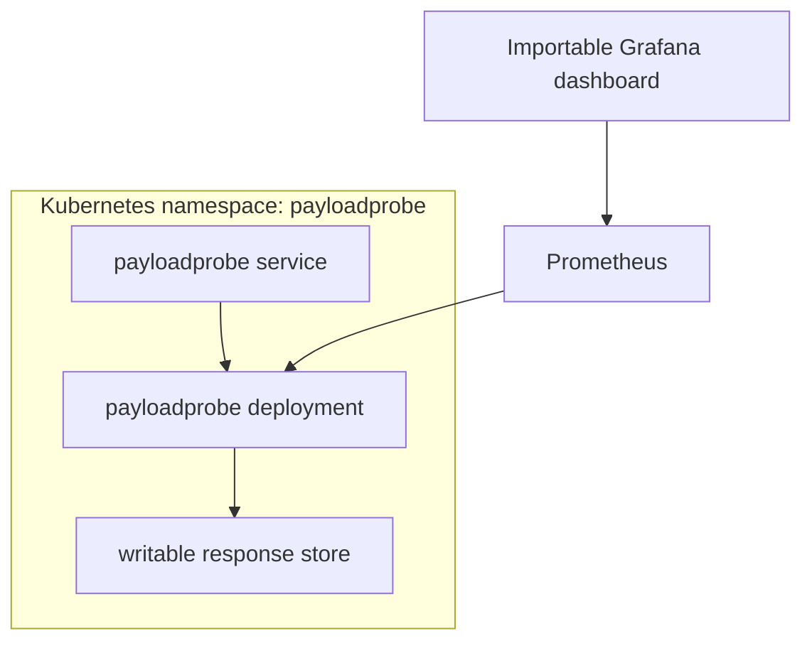

# Architecture

PayloadProbe Lab keeps the application intentionally small: one Spring Boot
service, one versioned JSON-backed response catalog with bounded history, and
clear HTTP boundaries.

## Response history

The response store keeps each key's current XML together with its retained
revisions in the same versioned JSON file. Creating a response, including a
response-set import, starts it at revision `1`. Each successful modern or
legacy update appends a revision, even if its XML equals the current XML. The
configured limit retains the latest 10 revisions per response by default,
including the current value; startup accepts values from 1 through 1000.

Revision identifiers advance monotonically for the lifetime of a key. When
retention prunes an older XML value, its identifier is not reused. Deleting a
key removes its history; recreating that key begins again at revision `1`.
History has no rollback operation. Promoting an older XML is an ordinary update
that appends a new revision, which keeps the change trail clear.

The existing flat `key -> XML` store format is recognized during startup and
eagerly migrated to the versioned single-file format. The migration uses the
same temporary-file and atomic-replacement path as normal writes: either the
old file remains intact or the complete versioned file replaces it. Current
catalog, response-set, and scenario operations still read the current XML only.

## Response-set export and import

`GET /api/response-sets` takes a snapshot of the catalog and returns a
versioned JSON document. `POST /api/response-sets` first parses and validates
every entry, then checks that none of its keys already exist. Only after those
checks pass does the store write the merged catalog to a temporary file in the
catalog directory and atomically replace the old file. A rejected document,
conflict, or persistence failure leaves the in-memory and on-disk catalog
unchanged.

The request body is read through a size-limited stream, so chunked requests do
not bypass the JSON document limit. Startup probes the catalog directory for
atomic-move support and fails clearly if the filesystem cannot provide it.

The import route is intentionally not an overwrite or synchronization API:
it only creates missing keys.

## Named scenarios

The scenario API stores reusable test selections separately from the XML
catalog. `PUT /api/scenarios/{name}` accepts an ordered, nonempty, unique list
of response keys. It checks the document size, name, key list, scenario limit,
and every current response reference before one atomic write to
`data/scenarios.json`. A validation failure, stale reference, capacity limit,
or persistence failure leaves the existing scenario file untouched.

`GET /api/scenarios` exposes only sorted scenario metadata. It intentionally
does not reveal response keys or XML. `GET /api/scenarios/{name}` resolves the
stored key sequence against a single current catalog snapshot and creates the
same version-1 response-set document used for catalog export. This keeps a
scenario importable while ensuring it always reflects the current XML. If any
reference has become stale, resolution stops with a fixed `409` response and
does not return a partial document. A bundle beyond the response-set export
limit returns its own fixed `409`.

The response catalog and scenario metadata use separate locks and files rather
than pretending to provide a cross-file transaction. PUT validates one catalog
snapshot immediately before the scenario write; a concurrent or later response
deletion may make that scenario stale. GET resolution always takes a fresh
catalog snapshot and fails closed instead of returning partial XML.

The scenario store uses the same atomic-move requirement as the response
catalog, but a different file and lock. It is not a synchronization or backup
mechanism; response-set export/import remains the portable catalog mechanism.

## Optional write authentication

Write authentication is disabled by default. When both
`PAYLOADPROBE_WRITE_AUTH_ENABLED=true` and a valid
`PAYLOADPROBE_WRITE_AUTH_BEARER_TOKEN` are configured, one request filter
protects exactly nine mutators: modern response create, update, and delete;
response-set import; scenario create/replace and delete; and legacy add,
update, and delete. It requires exactly one matching `Authorization: Bearer`
header before the controller or storage layer runs.

The filter leaves all `GET` routes and the compatibility-safe POST reads
(`POST /fetch/{key}`, `/default`, and `POST /api/responses/default`) public.
Authentication failures use a fixed `401` body, `WWW-Authenticate`, and
`Cache-Control: no-store`; the request logging boundary never records tokens.

This is a shared deployment secret, not user authentication. It provides no
individual roles or write audit trail. Production deployments still need TLS
and network access controls around the service.

## Component View

## Request Flow

## Deployment Topology

## Design Direction

The first version focuses on a stable modernization foundation. Store-level
metrics cover response lookups, misses, bounded write outcomes, and current
catalog size. One structured completion event records only allow-listed route
templates and fixed server metadata, never keys, request values, XML payloads,
or exception details. An importable Grafana dashboard provides a scan-first view
of scrape health, catalog activity, write outcomes, HTTP outcomes, and mean
latency without adding deployment dependencies. Daily automation can then add
persistence options, security controls, and deployment polish in small verified
steps.
